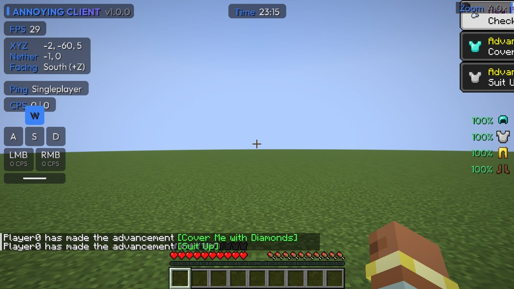
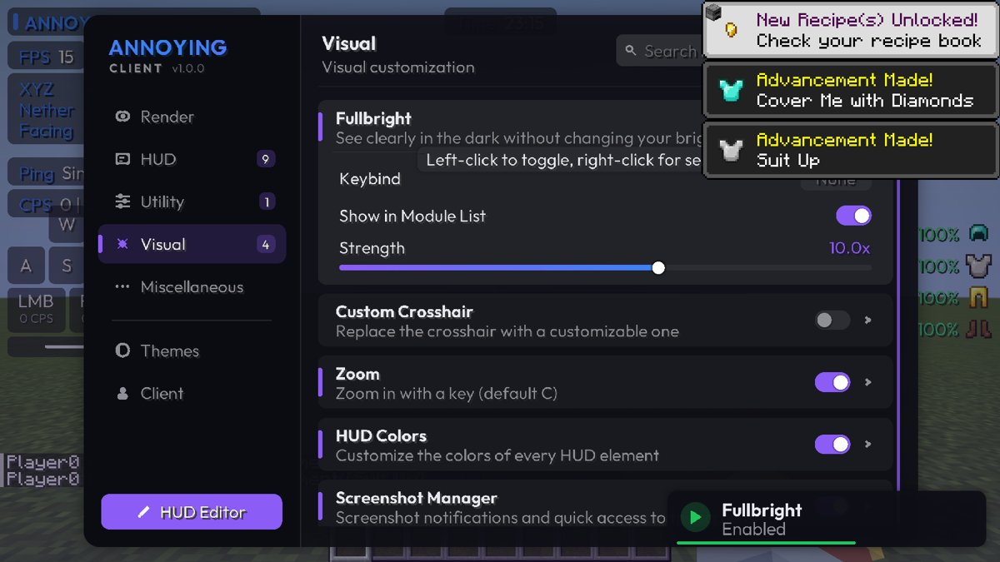
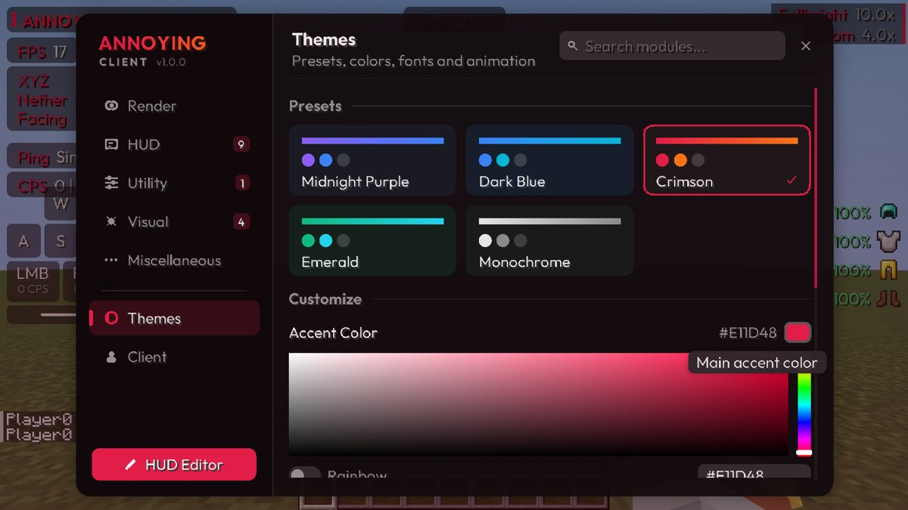
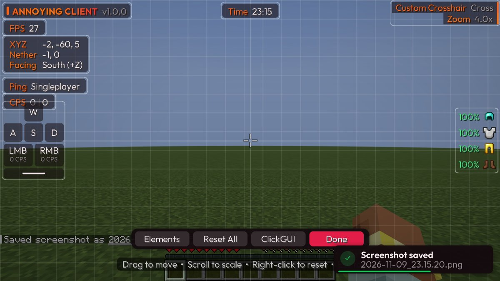
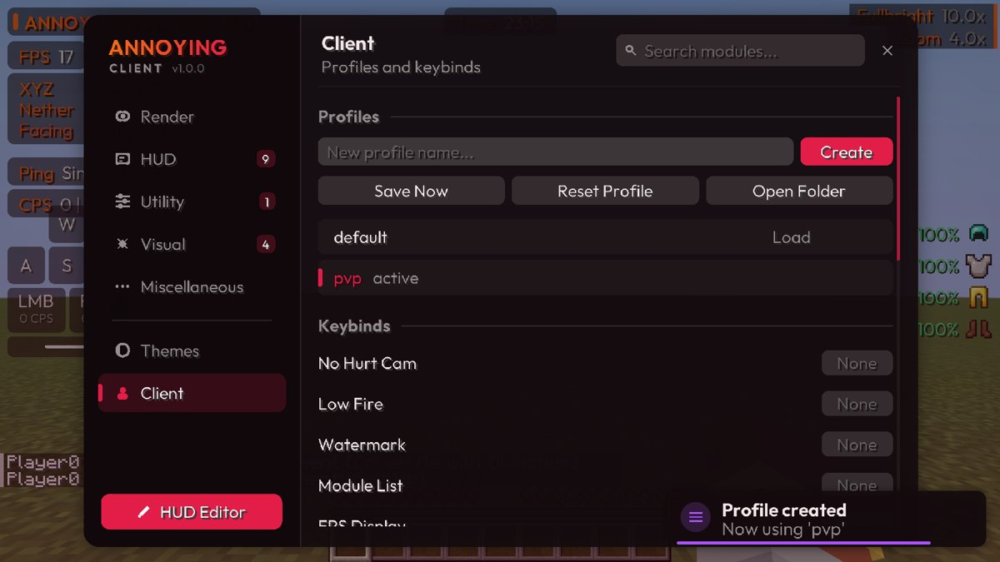

# ANNOYING CLIENT

A modular quality-of-life and visual client for **Minecraft Java Edition 1.21.11**, built on **Fabric**.
It has a ClickGUI, a drag-and-drop HUD editor, nine HUD elements, five themes, configuration profiles
and animated notifications.



| ClickGUI | Themes and color picker |
|---|---|
|  |  |
| **HUD editor** | **Profiles** |
|  |  |

Screenshots were taken automatically by the in-game test suite (software rendering, so FPS is low).

## Installation

### Annoying Client Launcher (recommended)
Download **`AnnoyingClient.exe`** and run it. No install step is needed: it downloads Minecraft 1.21.11, Fabric,
Java 21 and Annoying Client on the first Play. It also has a Modrinth mod browser and a Performance page
(Sodium, Lithium, FerriteCore, Entity Culling, ImmediatelyFast, FPS presets and memory tuning).
Press **Play** with *Via Minecraft Launcher* selected; the official launcher opens with the "Annoying Client" profile.
See [launcher/README.md](launcher/README.md).

### Windows installer
1. Install the official Minecraft Launcher and start it once.
2. Close the launcher, then run **`AnnoyingClient-Installer.exe`** and choose **[1] Install**.
3. Open the launcher, pick the **Annoying Client** profile, and press **Play**.

The installer is self-contained: Annoying Client, Fabric API and the Fabric Loader profile are embedded.
It installs into an isolated game folder, `%APPDATA%\.minecraft\annoying-client`, so your normal
`mods` folder is untouched, and it copies your `options.txt` and `servers.dat` there once. Running it
again upgrades the client; **[2] Uninstall** removes the profile and the installed files but keeps your
worlds and settings. Options: `-dir "<path to .minecraft>"`, `-install`, `-uninstall`, `-no-pause`.

The installer is not code-signed, so Windows SmartScreen may show "Windows protected your PC".
Click *More info > Run anyway*. Its source is in `installer/` and it is rebuilt with `installer/build.sh`.

### Manual installation
1. Install [Fabric Loader](https://fabricmc.net/use/installer/) **0.20.1 or newer** for **Minecraft 1.21.11**.
2. Download [Fabric API](https://modrinth.com/mod/fabric-api) for 1.21.11 (0.141.6 or newer).
3. Put `annoying-client-1.0.0+mc1.21.11.jar` **and** the Fabric API JAR into your `.minecraft/mods` folder.
4. Start the *fabric-loader-1.21.11* profile in the Minecraft Launcher.
5. Press **Right Shift** (or click the *Annoying Client* button on the title screen) to open the ClickGUI.

Requires Java 21 (bundled with the official launcher). Settings live in `.minecraft/config/annoyingclient/`.

## Controls

| Action | Default |
|---|---|
| Open / close the ClickGUI | Right Shift |
| Zoom (hold) | C |
| Search modules | Just start typing in the ClickGUI, or Ctrl+F |
| Next / previous tab | Tab / Shift+Tab, or scroll over the sidebar |
| Toggle a module | Left-click its card |
| Show a module's settings | Right-click its card (or click the arrow) |
| Reset a setting to default | Right-click the slider, color or keybind |
| Bind a key | Click the keybind box, press a key (Backspace or Delete unbinds, Esc cancels) |
| HUD editor | *HUD Editor* button in the ClickGUI, or bind the *HUD Editor* module |

Every module has its own keybind setting. All keybinds are also listed together in **ClickGUI > Client > Keybinds**.
Mouse buttons 3-5 (middle and side buttons) can be bound too.

## Features

### ClickGUI
- One draggable window with a category sidebar (Render, HUD, Utility, Visual, Miscellaneous, Themes, Client).
- Module cards with animated toggle switches. Settings expand inline and are generated automatically
  from each module's settings.
- Setting editors: switches, sliders, dropdowns, text fields, keybind capture, and an HSV color picker
  (saturation/value square, hue bar, alpha bar, rainbow mode, hex input).
- Live search across all modules, tooltips with descriptions, and smooth scrolling.
- Animations for opening and closing, tab changes, hover states, the tab indicator and expanding cards.
- The window scales with the *GUI Scale* setting and is clamped to fit any resolution.

### HUD
Watermark, FPS, Coordinates (with nether/overworld conversion and facing), Clock, Keystrokes (with CPS),
Armor HUD, CPS, Ping and an animated Module List.

Each element has position, scale, visibility, a background toggle and a custom color. Positions are
stored relative to the nearest screen edge or center, so the layout survives resolution and GUI scale changes.

**HUD editor:** drag elements (they snap to edges, the screen center and each other; hold Shift to
turn snapping off), scroll to scale, right-click to reset, arrow keys to nudge. Turn elements on and off
from the Elements panel.

### Modules
| Category | Modules |
|---|---|
| Render | No Hurt Cam, Low Fire |
| HUD | Watermark, Module List, FPS Display, Ping Display, CPS Display, Coordinates, Clock, Keystrokes, Armor HUD |
| Utility | ClickGUI, HUD Editor, Notifications, Profile Switcher, Theme Switcher |
| Visual | Fullbright, Custom Crosshair, Zoom, HUD Colors, Screenshot Manager |
| Miscellaneous | Background FPS |

- **Fullbright** raises the gamma used for the lightmap while it is enabled, with a fade. Your saved
  Brightness option is never changed.
- **Zoom** has hold or toggle activation, a factor from 1.5x to 30x, smooth animation, scroll-to-adjust,
  reduced sensitivity and an optional cinematic camera.
- **Custom Crosshair** offers Cross, Dot, Circle, T-Shape and Square styles with size, gap, thickness,
  color, outline and a center dot. Vanilla still decides when the crosshair is visible and still draws
  the attack indicator.
- **Screenshot Manager** shows a notification with the file name, counts screenshots this session, and
  has an *Open Folder* key.
- **HUD Colors** sets the HUD style: Theme, Static, Wave or Rainbow, plus background opacity and rounded corners.
- **Background FPS** caps the frame rate while the window is unfocused.

Everything is visual or quality-of-life. There are no cheats, anti-cheat bypasses, exploits or gameplay automation.

### Themes
Five presets: **Midnight Purple, Dark Blue, Crimson, Emerald, Monochrome**. You can customize the
accent color, secondary accent, background color, text color, panel opacity, animation speed, GUI scale,
font (bundled **Outfit** typeface or Minecraft's font), text shadow and background blur.
Every change applies on the next frame. Editing a color switches the preset label to *Custom*.

### Notifications
Success, error, info, warning, module enabled/disabled and configuration notifications slide in,
show a countdown bar, stack and re-flow smoothly, and disappear on their own. Duration, position and
module-toggle notifications are configurable in the *Notifications* module.

### Configuration
```
.minecraft/config/annoyingclient/
├── client.json              which profile is active
└── profiles/
    ├── default.json         module states, settings, keybinds, HUD positions, theme
    └── <name>.json
```
- Loads automatically at startup. Saves automatically about 1.5 s after the last change, plus on exit.
- Writes go to a temporary file and are then moved into place atomically, so a crash cannot leave a half-written profile.
- Create, load, delete, reset and save profiles in **ClickGUI > Client**. *Profile Switcher* cycles them with a key.
- Missing values fall back to defaults, invalid values are reset (with a warning notification), and a file
  that can't be parsed is kept as `<name>.corrupt-<time>.json` while defaults are loaded.

## Building from source

Requirements: **JDK 21**. The Gradle wrapper (9.2.1) downloads everything else.

```bash
./gradlew build
```

Output: `build/libs/annoying-client-<version>+mc1.21.11.jar` (the `-sources.jar` next to it holds the source code).

| Task | What it does |
|---|---|
| `./gradlew runClient` | Development client |
| `./gradlew runClientGameTest` | Automated in-game test (development environment) |
| `./gradlew runProductionClient` | Launches the release JAR with real Fabric Loader and Fabric API |
| `./gradlew runProductionClientGameTest` | Runs the automated test against the release JAR |
| `./gradlew genSources` | Decompiled, readable Minecraft sources for your IDE |

### IntelliJ IDEA
1. *File > Open*, select `build.gradle`, choose *Open as Project*.
2. Set the project SDK to Java 21.
3. After the Gradle sync, use the generated *Minecraft Client* run configuration.

### Automated tests
`src/gametest/java/com/annoyingclient/gametest/AnnoyingClientGameTest.java` drives a real client. It:
1. Creates a world and enables every HUD element.
2. Opens the ClickGUI with Right Shift and clicks through tabs, cards, settings, search, themes, the color picker and profile creation.
3. Checks a keybind, Fullbright, the custom crosshair, Zoom and an F2 screenshot notification.
4. Drags an element in the HUD editor.
5. Verifies the saved JSON, recovery from a corrupted profile, and restoring a profile.

It saves screenshots of each step to `build/run/clientGameTest/screenshots/` and fails on any wrong result.

## Project structure

```
src/main/java/com/annoyingclient/
├── AnnoyingClient.java        Entry point: startup order, module registration, callbacks
├── event/                     EventBus and events (tick, key, mouse, scroll)
├── manager/                   ModuleManager, KeybindManager
├── module/                    Module base class, Category
│   └── impl/{render,utility,visual,misc}/
├── setting/                   Boolean, Number, Mode, Color, String and Keybind settings
├── gui/clickgui/              ClickGuiScreen
├── gui/component/             Widgets: module card, setting editors, text field, color picker, panels
├── hud/                       HudModule base, HudManager, HudEditorScreen
│   └── element/               The nine HUD elements
├── config/                    ConfigManager (Gson, profiles, auto-save, recovery)
├── theme/                     Theme presets and ThemeManager
├── notification/              NotificationManager and types
├── render/                    RenderUtil (rounded rects, shadows, gradients), TextRenderer, Icons, Textures
├── util/                      Animation, Easing, ColorUtil, MathUtil, CpsTracker
└── mixin/                     Small hooks into Minecraft that only forward to client systems
src/main/resources/
├── fabric.mod.json, annoyingclient.mixins.json
└── assets/annoyingclient/     icon, language file, Outfit font (SIL OFL 1.1)
src/gametest/                  Automated in-game tests (not part of the mod JAR)
```

### Adding a module
```java
public class MyModule extends Module {
    private final BooleanSetting option = add(new BooleanSetting("Option", "What it does", true));

    public MyModule() {
        super("My Module", "Short description", Category.MISC, false, KeybindSetting.NONE);
    }

    @Override protected void onEnable() { /* ... */ }
    @Override protected void onDisable() { /* ... */ }
}
```
Register it in `AnnoyingClient#registerModules()`. The ClickGUI, keybinds, Module List and
configuration pick it up automatically. For a HUD element, extend `HudModule` and draw at (0, 0) in `renderContent`.

## Versions

| Component | Version |
|---|---|
| Minecraft | 1.21.11 |
| Fabric Loader | 0.20.1 |
| Fabric API | 0.141.6+1.21.11 |
| Fabric Loom | 1.14.10 |
| Gradle | 9.2.1 |
| Java | 21 |
| Mappings | Official Mojang mappings |

Minecraft 26.x ships with Mojang names and needs Java 25. Because this project already uses Mojang
mappings, porting is mostly a version update plus fixes wherever the game's code changed.

## License

Code: MIT, see [LICENSE](LICENSE).
Bundled font: Outfit, © The Outfit Project Authors, SIL Open Font License 1.1
(`src/main/resources/assets/annoyingclient/font/outfit_ofl_license.txt`).
